<a href="https://darshan-portfolio-6vo.pages.dev/">
  <picture>
    <source media="(prefers-color-scheme: dark)" srcset="assets/hero-dark.svg">
    
  </picture>
</a>

### Hi, I'm Darshan

Backend and Android engineer. I build systems that stay correct when it matters: orders that can't oversell, payments that can't double-charge, ledgers that always balance. Every project here is test-first and load-tested.

[Portfolio](https://darshan-portfolio-6vo.pages.dev/) · [Email](mailto:sonawanedarshan35@gmail.com)

#### Projects

Each card loops the one thing that project refuses to get wrong. Click a card to open the repo.

<a href="https://github.com/Darshan-05032003/core-banking-ledger"><picture><source media="(prefers-color-scheme: dark)" srcset="assets/card-ledger-dark.svg"></picture></a>
<a href="https://github.com/Darshan-05032003/ecommerce-backend"><picture><source media="(prefers-color-scheme: dark)" srcset="assets/card-race-dark.svg"></picture></a>

<a href="https://github.com/Darshan-05032003/PayFlow"><picture><source media="(prefers-color-scheme: dark)" srcset="assets/card-retry-dark.svg"></picture></a>
<a href="https://github.com/Darshan-05032003/CheckoutKit"><picture><source media="(prefers-color-scheme: dark)" srcset="assets/card-states-dark.svg"></picture></a>

- **[core-banking-ledger](https://github.com/Darshan-05032003/core-banking-ledger)**: Double-entry, append-only ledger with maker-checker approvals and a transactional outbox to Kafka. 711 tests, 98.5% coverage.
- **[ecommerce-backend](https://github.com/Darshan-05032003/ecommerce-backend)**: Spring Boot store backend that never oversells under concurrent orders, with idempotent checkout and rotating refresh tokens. 600 tests, 99.3% coverage.
- **[PayFlow](https://github.com/Darshan-05032003/PayFlow)**: Android payments app where retries never double-charge, load-tested with 1,000 concurrent payments against a failing gateway.
- **[CheckoutKit](https://github.com/Darshan-05032003/CheckoutKit)**: Kotlin Multiplatform payment SDK built on a pure state machine, so a payment can't reach an illegal state.
- **[transaction-reconciliation-batch](https://github.com/Darshan-05032003/transaction-reconciliation-batch)**: Restartable batch job that matches ledger against bank statements and classifies every break. 309 tests, 97.0% coverage.
- **[SplitSmart](https://github.com/Darshan-05032003/SplitSmart)**: Snap a receipt, and on-device OCR plus an LLM turn it into line items with paise-exact splits and UPI settle-up.

#### Tools I use

<picture>
  <source media="(prefers-color-scheme: dark)" srcset="assets/stack-dark.svg">
  
</picture>

#### Open to

Backend or Android SDE roles, and freelance work on Spring Boot backends and Kotlin Android apps.
