  <a href="https://darshan-05032003.github.io/Portfolio/"><b>Try the systems live →</b></a>&nbsp;&nbsp;·&nbsp;&nbsp;
  <a href="mailto:sonawanedarshan35@gmail.com">sonawanedarshan35@gmail.com</a>

I build backends that stay correct when twenty people click at once, and Android apps that keep working after you close them.

Every repository below follows the same rule: pick the one guarantee that matters, write the test that would catch its failure, build until it's green, and keep it green in CI with a coverage gate. The numbers are copied from each repo's own README, and you can run every one of them with `docker compose up` or `./gradlew test`.

 

## Ledger

| Repository | The guarantee | Stack | Figure |
|:--|:--|:--|--:|
| [**core-banking-ledger**](https://github.com/Darshan-05032003/core-banking-ledger) | Money is never a number you overwrite. Double-entry, append-only (Postgres triggers reject `UPDATE`/`DELETE`), corrected only by reversal. Transfers lock rows in id order instead of `SERIALIZABLE`; idempotency decided by a unique constraint; maker-checker holds; transactional outbox to Kafka. | Java 21 · Spring Boot 4 · PostgreSQL · Kafka | **711 tests** 98.5% line |
| [**ecommerce-backend**](https://github.com/Darshan-05032003/ecommerce-backend) | Stock that cannot be oversold: one conditional `UPDATE … WHERE stock >= ?` per line, lines in product-id order. A test fires 20 concurrent buyers at the last 5 units and expects exactly 5 orders. Idempotent order placement, rotating refresh-token families, emails only after commit. | Java 21 · Spring Boot 4 · MySQL · Redis | **600 tests** 99.3% line |
| [**transaction-reconciliation-batch**](https://github.com/Darshan-05032003/transaction-reconciliation-batch) | Million-line statement files loaded exactly once, matched set-wise against the ledger, every break classified and resolved under maker/approver control. Restartable after a mid-run failure without duplicating work. | Java 21 · Spring Batch · PostgreSQL | **309 tests** 97.0% line |
| [**CheckoutKit**](https://github.com/Darshan-05032003/CheckoutKit) | A drop-in payment SDK whose state machine cannot be pushed into an illegal state: all 49 state/event pairs tested, compare-and-set transitions, idempotent retries, and reconciliation so a timeout is never reported as "failed" while money may be captured. Published on JitPack. | Kotlin Multiplatform · Compose | **97.5%** core coverage |
| [**PayFlow**](https://github.com/Darshan-05032003/PayFlow) | A UPI payments app built the way a payments team would: idempotency keys stored before the PSP call, status polling with backoff and jitter, QR scan-to-pay, AutoPay mandates, Keystore AES-GCM, biometric lock, root detection. | Kotlin · Compose · Room · ML Kit | **1,000** concurrent payments, 0 duplicates |
| [**GeoGuard**](https://github.com/Darshan-05032003/GeoGuard) | A group safe zone that alerts every other member when someone leaves it, with the app killed. OS geofencing instead of GPS polling, WorkManager uploads that survive bad networks, deterministic event ids so a retry never duplicates an alert, server-side FCM fan-out so no secrets ship in the APK. | Kotlin · Compose · Firebase | **0** secrets in the APK |
| [**SplitSmart**](https://github.com/Darshan-05032003/SplitSmart) | Photograph a receipt, on-device OCR plus an LLM turns it into line items, split paise-exactly with proportional tax and tip, settle with one-tap UPI links. Offline-first with a regex fallback. | Kotlin · Compose · Hilt · Gemini | **95.2%** domain + data coverage |
| [**FinPay**](https://github.com/Darshan-05032003/Fin_Pay) | A fintech UI built test-first: exact-paise ledger, salted credential hashing, idempotent payments, physics-based motion, and a stress suite pushing 100,000 ledger rows and 1,000-tap storms through the real screens. | Flutter · sqflite | **1,500+ tests** 144 golden baselines |
| [**ai-customer-support-agent**](https://github.com/Darshan-05032003/ai-customer-support-agent) | Classifies support tweets by intent, drafts replies grounded in a brand's history, escalates what it cannot answer and explains each decision. Reproducibility and honest evaluation over system size. | Python | **99.8%** conversation-link integrity |

 

## How I work

- **One hard guarantee per system.** Not CRUD with a UI on top. The ledger instead of the to-do app; the race test instead of the screenshot.
- **Tests that would catch the real failure.** Concurrency tests use start latches, never `sleep`. Time-dependent code reads an injected `Clock`. Integration tests run on real databases through Testcontainers.
- **Break it on purpose.** After each feature: a security pass, then load and chaos simulations (retry storms, 429 floods, latency spikes, partial PSP outages) with the results written into the README.
- **A README anyone can run.** Architecture and sequence diagrams, every design decision with its trade-off, `docker compose up --build -d --wait`, and the coverage number from the last real run.

 

## Kit

| | |
|:--|:--|
| **Backend** | Java 21, Spring Boot 4, Spring Security, Spring Batch, JPA/Hibernate, Flyway, PostgreSQL, MySQL, Redis, Kafka |
| **Android** | Kotlin, Jetpack Compose, MVVM, Hilt, Room, WorkManager, CameraX, ML Kit, Geofencing API, Keystore, Firebase (Auth, Firestore, Functions, FCM), Flutter |
| **Testing** | JUnit 5, Mockito, Testcontainers, Awaitility, ArchUnit, JaCoCo and Kover gates, golden tests, load and chaos simulations |
| **Delivery** | Docker multi-stage, docker compose, GitHub Actions, JitPack, Actuator, Micrometer/Prometheus |

 

## Work with me

**Freelance** — well-scoped backends in Spring Boot or Android apps in Kotlin/Compose, with tests, Docker and CI from day one; or fixing concurrency, double-charge and data-integrity bugs in systems you already have. You get a repo you own, a README anyone can run, and a short walkthrough video.

**Full-time** — backend or Android SDE roles on teams that care about how systems behave under load.

  <a href="mailto:sonawanedarshan35@gmail.com">sonawanedarshan35@gmail.com</a>&nbsp;&nbsp;·&nbsp;&nbsp;
  <a href="https://darshan-05032003.github.io/Portfolio/">Portfolio</a>

Closing balance: oversold units 0 · double charges 0 · unbalanced journals accepted 0 · books balanced.
