<a href="https://darshan-portfolio-6vo.pages.dev/">
  <picture>
    <source media="(prefers-color-scheme: dark)" srcset="assets/hero-dark.svg">
    
  </picture>
</a>

  <a href="https://darshan-portfolio-6vo.pages.dev/">
    <picture>
      <source media="(prefers-color-scheme: dark)" srcset="assets/cta-dark.svg">
      
    </picture>
  </a>
   
  Break an oversell race, retry a payment, try to edit a ledger — in your browser.

 

## Watch the guarantees hold

Every card is a looping replay of the one thing that project refuses to get wrong. Click a card to open its repository.

<a href="https://github.com/Darshan-05032003/ecommerce-backend"><picture><source media="(prefers-color-scheme: dark)" srcset="assets/card-race-dark.svg"></picture></a>
<a href="https://github.com/Darshan-05032003/core-banking-ledger"><picture><source media="(prefers-color-scheme: dark)" srcset="assets/card-ledger-dark.svg"></picture></a>

<a href="https://github.com/Darshan-05032003/CheckoutKit"><picture><source media="(prefers-color-scheme: dark)" srcset="assets/card-states-dark.svg"></picture></a>
<a href="https://github.com/Darshan-05032003/PayFlow"><picture><source media="(prefers-color-scheme: dark)" srcset="assets/card-retry-dark.svg"></picture></a>

<a href="https://github.com/Darshan-05032003/transaction-reconciliation-batch"><picture><source media="(prefers-color-scheme: dark)" srcset="assets/card-recon-dark.svg"></picture></a>

 

## Open the hood

Click any line to expand the design decisions behind it.

<b>ecommerce-backend</b> — how 20 buyers can't oversell 5 units

 

- **One conditional `UPDATE` per order line:** `stock = stock − ? WHERE id = ? AND stock >= ?`. Zero affected rows rolls the whole order back. Lines are reserved in product-id order, so two orders can't deadlock.
- **Idempotent order placement:** key, user, SHA-256 of the body and the response are stored in the order transaction. A replay returns the stored response; the same key with a different body is `422`.
- **Refresh-token families:** 256-bit opaque tokens stored as hashes, rotated on every use. Replaying a used token revokes the whole family.
- **Side effects only after commit:** emails run on `@TransactionalEventListener(AFTER_COMMIT)`, so a rolled-back order never sends one.
- **Tests never sleep:** start latches for concurrency, Awaitility for async, an injected `Clock` for time. 600 tests, 99.3% line coverage on real MySQL and Redis via Testcontainers.

<b>core-banking-ledger</b> — why the books always balance

 

- **Double-entry, append-only:** every event is a journal whose debits equal its credits. Postgres triggers reject `UPDATE`, `DELETE` and `TRUNCATE` on the ledger; mistakes are corrected by a linked reversal.
- **Lock ordering instead of `SERIALIZABLE`:** both balance rows are locked in ascending account-id order with a `lock_timeout`, so opposite transfers queue instead of deadlocking.
- **Idempotency decided by the database:** the key is claimed by a unique insert in its own short transaction.
- **Maker-checker with holds:** large transfers reduce available balance, not ledger balance, until a different user with the CHECKER role decides.
- **Transactional outbox to Kafka:** the event commits with the journal; the consumer de-duplicates. 711 tests, 98.5% line coverage.

<b>CheckoutKit</b> — a payment that can't reach an illegal state

 

- **Pure transition function:** all 49 state × event pairs tested exhaustively, applied with compare-and-set so racing events can't corrupt a payment.
- **Reconciliation over guessing:** a timeout is never reported as "failed" while money may have been captured; the SDK looks the payment up by key first.
- **Retry storm tested:** 10,000 sessions against a gateway failing 50% of attempts never exceed `maxAttempts` per key.
- **Kotlin Multiplatform core + Compose sheet,** published on JitPack. 97.5% core line coverage.

<b>PayFlow</b> — retries that never double-charge

 

- **Idempotency key stored in Room before the PSP call,** so a crash between "sent" and "saved" can't produce a second charge.
- **Status polling with exponential backoff and jitter;** success only after PSP confirmation.
- **Hardened client:** Keystore AES-GCM, biometric/PIN lock with PBKDF2 and lockout, root/tamper detection, `FLAG_SECURE`.
- **Load-tested:** 1,000 concurrent payments against a PSP with 20% failures, 10% timeouts and 5% 5xx, zero duplicate or orphan payments.

<b>transaction-reconciliation-batch</b> — every break explained, every restart safe

 

- **Exactly-once ingestion:** SHA-256 duplicate check, header/trailer control totals, bad lines skipped and reported.
- **Set-wise matching:** partitioned `FULL OUTER JOIN` by reference; every difference is classified as a break.
- **Maker/approver resolution** with a full audit of who decided what and why.
- **Restartable:** a job that fails mid-file resumes where it stopped without re-posting. 309 tests, 97.0% line coverage.

 

## Same guarantees, from a terminal

<picture>
  <source media="(prefers-color-scheme: dark)" srcset="assets/terminal-dark.svg">
  
</picture>

 

## Kit

<picture>
  <source media="(prefers-color-scheme: dark)" srcset="assets/stack-dark.svg">
  
</picture>

<b>More repositories</b>

 

| | | |
|:--|:--|--:|
| [**SplitSmart**](https://github.com/Darshan-05032003/SplitSmart) | Photograph a receipt; on-device OCR + an LLM turn it into line items; paise-exact splits; one-tap UPI settle-up. Offline-first. | 95.2% coverage |
| [**FinPay**](https://github.com/Darshan-05032003/Fin_Pay) | Fintech UI built test-first: exact-paise ledger, idempotent payments, physics-based motion, 100,000-row stress suite. | 1,500+ tests |
| [**ai-customer-support-agent**](https://github.com/Darshan-05032003/ai-customer-support-agent) | Classifies support tweets by intent, drafts grounded replies, escalates and explains each decision. | 99.8% link integrity |
| [**Portfolio**](https://github.com/Darshan-05032003/Portfolio) | The live labs page: one HTML file, no framework, simulations covered by unit tests. | 21 tests |

 

## Work with me

**Freelance:** Spring Boot backends or Kotlin/Compose Android apps with tests, Docker and CI from day one. I also fix concurrency, double-charge and data-integrity bugs in systems you already run. You get a repo you own, a README anyone can run, and a short walkthrough video.

**Full-time:** backend or Android SDE roles on teams that care how systems behave under load.

  <a href="mailto:sonawanedarshan35@gmail.com"><b>sonawanedarshan35@gmail.com</b></a>&nbsp;&nbsp;·&nbsp;&nbsp;
  <a href="https://darshan-portfolio-6vo.pages.dev/">Live portfolio</a>

Every animation on this page is a hand-written SVG with plain CSS: no JavaScript, no third-party widgets, no Actions. Source: <a href="tools/gen_svgs.py"><code>tools/gen_svgs.py</code></a>.
